# InnovX — Formal 2-Page Mentor Evaluation & Grading Briefing

> **Project Title:** InnovX — AI-Powered Innovation Discovery, Validation & Commercialization Engine  
> **Evaluation Period:** Phase 4: Final Handover (Day 28 of 30-Day Sprint)  
> **Author / Candidate:** Srihari S  
> **Target Evaluation:** Capstone Evaluation, Technical Rigor Audit & Commercial Viability Assessment  

---

## 1. Executive Summary & Problem Addressed

Every year, millions of engineering concepts and research ideas stall in the "valley of death" between ideation and commercial realization. Innovators confront three systemic bottlenecks:
1. **The Prior Art Blindspot:** Over 250M+ academic papers and patent documents exist, but searching them is manual, fragmented, or cost-prohibitive.
2. **Generative AI Hallucination:** Standard commercial LLMs frequently fabricate citations, DOIs, and patent claim references, making them legally and technically dangerous for intellectual property diligence.
3. **The Commercial Execution Void:** Existing research tools provide raw document lists but leave creators stranded without clear next steps (patenting, open publishing, licensing, or crowdfunding).

**InnovX** eliminates these barriers. It is an end-to-end software platform that accepts natural language technical concepts, extracts atomic features, triangulates them concurrently across three open scientific indices (**OpenAlex, arXiv, USPTO**), ranks candidate prior art using **Reciprocal Rank Fusion (RRF, $k=60$)**, quotes verbatim sentence-level evidence, scores novelty across 6 objective metrics, streams a publication-grade 10-section PDF report, and routes the inventor into **4 tangible commercialization pathways (Protect / Share / Connect / Build)**.

---

## 2. Key Technical Innovations & System Rigor

```mermaid
graph LR
    Input["Natural Language Idea"] --> Structuring["AI Feature Decomposition<br/>(Gemini Flash Lite)"]
    Structuring --> Search["Concurrent API Search<br/>(OpenAlex + arXiv + USPTO)"]
    Search --> RRF["Reciprocal Rank Fusion<br/>(MiniLM 384-dim + BM25)"]
    RRF --> Evidence["Verbatim Evidence Extraction<br/>(Sentence-Level Grounding)"]
    Evidence --> Report["10-Section PDF Report<br/>(ReportLab Streaming)"]
    Report --> DecisionHub["Decision Hub (4 Paths)<br/>Protect · Share · Connect · Build"]
    DecisionHub --> Vault["Private Vault & SHA-256 Provenance<br/>(Tamper-Evident History)"]
```

1. **Deterministic Reciprocal Rank Fusion (RRF):** Fuses dense semantic vector representations (`all-MiniLM-L6-v2`, running locally on CPU in ~10ms with zero API fees) with sparse Okapi BM25 keyword rankings.
2. **Arrow's Information Paradox Resolution:** The NDA-Gated Marketplace features an AI Sanitizer that automatically generates non-confidential public teasers while strictly withholding patentable equations and claim boundaries until a legally binding Mutual NDA is executed.
3. **Cryptographic Tamper-Evident Version Chains:** Every idea refinement generates an immutable SHA-256 hash record ($H_n = \text{SHA-256}(S_n \parallel H_{n-1})$) allowing instant mathematical proof of prior inventorship without blockchain overhead.
4. **Zero-Dependency Streaming PDF Engine:** Built directly with ReportLab 5.0.1 in Python, producing multi-page branded legal disclosures and patent preparation briefs on-the-fly.

---

## 3. Sprint Deliverables & Milestone Proof Matrix

| Phase & Timeline | Milestones Achieved | Deliverable / Verification Proof | Status |
|:---|:---|:---|:---:|
| **Week 1: The Brain** (Days 1 – 7) | Core AI pipeline, multi-source search (OpenAlex, arXiv, USPTO), local CPU embeddings, sentence evidence extraction, feature matrix. | Working full pipeline running via `POST /api/analyze`; all Windows gRPC and encoding bug fixes applied. | ✅ 100% Complete |
| **Week 2: The Report & Vault** (Days 8 – 14) | 6-metric assessment engine, 10-section report generator, streaming ReportLab PDF export, Supabase Auth (JWT), encrypted 10MB file storage, and SHA-256 provenance timeline. | Verified streaming PDF downloads via `GET /api/report/{id}/pdf`; live cryptographic chain verification in Creator Vault. | ✅ 100% Complete |
| **Week 3: The Paths** (Days 15 – 21) | Post-Report Decision Hub, Patent Prep package (🛡️ Protect), Defensive Publication generator (🌍 Share), NDA Marketplace & AI Sanitizer (🤝 Connect), and in-platform confidential messaging. | Verified in `test_week3_end_to_end.py` with zero IP leakage across dual roles (Creator vs. Unapproved Buyer). | ✅ 100% Complete |
| **Week 4: The Launch** (Days 22 – 28) | Crowdfunding generator (🚀 Build), landing page with interactive sample tour, hybrid RRF search, Render/Vercel production deploy specs, and Day 27 master regression suite. | All 6 journeys verified in `test_day27_regression.py` (runtime: 6.2s); Next.js production build passing with 0 errors. | ✅ 100% Complete |

---

## 4. Quality Assurance, Test Coverage & Performance Metrics

* **Master Regression Suite:** `backend/test_day27_regression.py` rigorously validates:
  1. *Journey 1:* Full pipeline analysis, 10-section report caching, and ReportLab PDF streaming.
  2. *Journey 2:* Patent readiness package generation, CPC classification, and claim boundaries.
  3. *Journey 3:* Defensive publication export, statutory disclaimer, and forfeiture warnings.
  4. *Journey 4:* AI listing sanitization, Mutual NDA access request flow, and confidential messaging.
  5. *Journey 5:* Crowdfunding campaign packages (Kickstarter, Indiegogo, Crowd Supply) and PDF export.
  6. *Journey 6:* Cryptographic SHA-256 hash chains, version evolution, and intentional tamper detection.
* **Latency Optimization:** Asynchronous concurrency across search APIs and parallel batch evidence extraction reduced total pipeline latency from **45 seconds down to under 10 seconds**.
* **Test Execution Speed:** Master regression suite completes all 6 end-to-end tests in **6.21 seconds**.
* **Frontend Compilation:** Next.js 14 / Turbopack production build (`npm run build`) builds all static and dynamic routes cleanly in **13.9 seconds** with zero TypeScript or lint errors.

---

## 5. Grading Rubric Self-Assessment

| Evaluation Criteria | Target Standard | InnovX Implementation Evidence |
|:---|:---|:---|
| **Technical Complexity & Architecture** | Multi-tiered, resilient, full-stack system with local AI integration. | Decoupled Next.js 14 + FastAPI + Supabase architecture; local PyTorch CPU embeddings; hybrid RRF search. |
| **Data Integrity & Grounding** | Zero-hallucination citations with evidence traceability. | Direct verbatim quote extraction linked to primary DOI / USPTO URLs; non-negotiable Rule 2 enforced. |
| **Commercial & Legal Viability** | Real-world intellectual property guardrails. | Enforces statutory patent disclaimers, trade secret shielding, forfeiture alerts, and Mutual NDA gating. |
| **Code Quality & Documentation** | Production-ready, fully documented, and tested. | 100% test pass rates, complete Mermaid system diagrams, deployment guide, and clean git history. |
