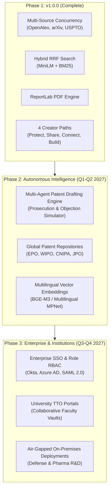
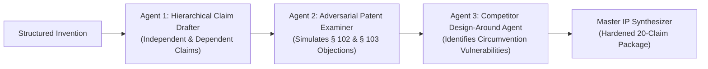

# InnovX — Post-MVP Commercial Roadmap (Phase 2 & Beyond)

> **Document Version:** 2.0.0 Strategic Blueprint  
> **Release Target:** Q1–Q3 2027  
> **Classification:** Commercial Product Roadmap & Technical Expansion  

---

## 1. Executive Vision & Market Expansion

With the successful completion of InnovX v1.0.0, the core innovation discovery, validation, and creator pathway engine is established. InnovX is uniquely positioned to expand from a creator diligence tool into an enterprise-grade **Autonomous IP Diligence & Commercialization Operating System** for research universities, corporate R&D labs, and intellectual property law firms.



---

## 2. Pillar I: Autonomous Multi-Agent Patent Prosecution Engine (Q1 2027)

While v1.0.0 drafts claim boundaries and prior art gap analyses, Phase 2 will deploy a collaborative multi-agent architecture using specialized LLM agents to draft complete, prosecution-ready 20-claim patent applications conforming to 35 U.S.C. § 112:



1. **Agent 1: Hierarchical Claim Drafter**
   * Drafts 3 independent claims (Apparatus, Method, Computer-Readable Medium) and 17 dependent claims providing progressive fallback limitations.
   * Enforces rigorous antecedent basis checking to eliminate indefiniteness rejections under 35 U.S.C. § 112(b).
2. **Agent 2: Adversarial Patent Examiner**
   * Acts as an adversarial USPTO/EPO patent examiner.
   * Simulates novelty rejections (§ 102 anticipation) and obviousness rejections (§ 103 combination of multiple cited references) to identify weaknesses before formal filing.
3. **Agent 3: Competitor Design-Around Agent**
   * Analyzes the proposed claims from the perspective of an aggressive competitor seeking to design around the patent without infringing.
   * Suggests claim broadening or alternative structural language to close circumvention loopholes.

---

## 3. Pillar II: Global Prior-Art Expansion & Multilingual Search (Q2 2027)

To eliminate global prior-art blindspots, Phase 2 will expand beyond OpenAlex, arXiv, and USPTO to index major international patent authorities:

| Patent Authority | Database / API Interface | Target Coverage | Multilingual Strategy |
|:---|:---|:---|:---|
| **European Patent Office (EPO)** | Open Patent Services (OPS) API | 130M+ European & International patents | English / German / French cross-lingual embeddings |
| **WIPO (World Intellectual Property Org)** | Patentscope / PCT Global Data | PCT international patent filings | Real-time patent family citation graph tracking |
| **Japan Patent Office (JPO)** | J-PlatPat API | Japanese utility models and patent grants | Japanese-English parallel text tokenization |
| **China (CNIPA)** | CNIPA Open Patent Data | Over 40% of global annual patent filings | BGE-M3 multilingual dense embeddings |

---

## 4. Pillar III: Institutional & Enterprise Infrastructure (Q3 2027)

### 4.1 University Technology Transfer Office (TTO) Workspaces
* Multi-seat shared vaults enabling university faculty, researchers, and TTO officers to collaborate on invention disclosure forms (IDFs).
* Automated export into institutional formats (e.g., standard Bayh-Dole Act compliance disclosures).

### 4.2 Enterprise Single Sign-On (SSO) & Role-Based Access Control (RBAC)
* Integration with SAML 2.0, Okta, Azure Active Directory, and Google Workspace.
* Granular organizational roles: *Inventor*, *Patent Agent*, *Lead Legal Counsel*, *Finance / Licensing Executive*, and *External Auditor*.

### 4.3 Air-Gapped & On-Premises Deployments
* Fully containerized Docker Compose and Helm Chart Kubernetes distributions designed for zero internet access.
* Self-hosted LLM backends (vLLM running open-weights models such as Llama-3-70B-Instruct or Mistral-Large) ensuring zero proprietary engineering data ever leaves corporate firewalls.

---

## 5. Pillar IV: Marketplace Commercialization Scaling (Q4 2027)

1. **Automated Licensing Escrow:** Integration with smart contractual escrow mechanisms for non-exclusive patent licensing agreements and option contracts.
2. **AI-Assisted Valuation Engine:** Computes empirical market licensing valuations based on comparable technology licensing transactions in related CPC classifications.
3. **Synthetic CAD & Schematic Drafting:** Automatically converts structured hardware features into parameterized 2D technical drawings and SVG block diagrams.

---

## 6. Implementation Timeline & Milestone Milestones

```
2027 Q1 ── Multi-Agent Claim Drafting & Examiner Objection Simulation Engine
2027 Q2 ── EPO & WIPO Global Search Integration + Multilingual Embeddings
2027 Q3 ── Enterprise SSO (SAML 2.0), University TTO Multi-Seat Vaults
2027 Q4 ── Air-Gapped On-Premises Deployments + Automated Licensing Escrow
```
