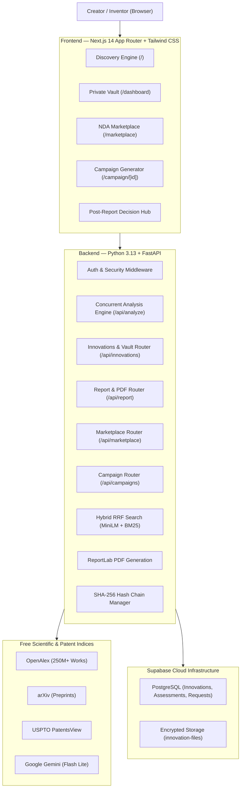

# InnovX — AI-Powered Innovation Discovery, Validation & Commercialization Engine

[](https://fastapi.tiangolo.com)
[](https://nextjs.org)
[](https://python.org)
[](https://www.typescriptlang.org)
[](https://supabase.com)
[](LICENSE)

> InnovX bridges the gap between technical ideation, rigorous academic search, and real-world commercial execution. Submit an engineering or scientific concept, decompose it into atomic technical features, triangulate across **250M+ OpenAlex research works, arXiv preprints, and USPTO patents**, compute objective novelty metrics, generate a publication-grade PDF report, and take immediate action through **4 post-report execution pathways**.

---

## 🌟 Key Highlights

* **Zero-Hallucination Evidence Extraction:** Unlike conversational LLMs that hallucinate academic citations, InnovX retrieves real documents and quotes verbatim evidence sentences directly from primary sources.
* **Hybrid Reciprocal Rank Fusion (RRF, $k=60$):** Combines dense semantic vector embeddings (`all-MiniLM-L6-v2`, 384-dim, running locally on CPU in ~10ms) with lexical Okapi BM25 keyword ranking for optimal precision.
* **Multi-Source Concurrency:** Concurrently queries OpenAlex, arXiv, and USPTO PatentsView APIs, returning fused, ranked candidates in under 2 seconds.
* **Objective 6-Metric Assessment Engine:** Evaluates Prior Art Density, Feature Novelty Signal, Combination Distinctiveness, Research Freshness, Evidence Strength, and Search Confidence with comprehensive disclaimers.
* **Enterprise Streaming PDF Export:** One-click streaming of 10-section styled ReportLab PDF reports directly to the browser with zero external binary OS dependencies.
* **The 4 Post-Report Execution Pathways (Decision Hub):**
  * 🛡️ **Protect:** Patent Filing Preparation Package (CPC classes, independent claim boundaries, prior art gaps, 12-month priority checklist, PDF export).
  * 🌍 **Share:** Defensive Publication Generator (IP.com / IBM TDB format, alternative embodiments, statutory rights forfeiture warning, Markdown/PDF export).
  * 🤝 **Connect:** NDA-Gated Technology Marketplace (AI Sanitizer teaser resolving the disclosure paradox, Mutual NDA execution, confidential in-platform messaging).
  * 🚀 **Build:** Crowdfunding Campaign Generator (Kickstarter, Indiegogo, Crowd Supply formatting, tiered backer rewards, video scripts, BOM budget allocations).
* **Private Innovation Vault & Cryptographic Provenance:** Secure storage for CAD drawings and test data up to 10MB, lab notes, and automated **SHA-256 version trees** providing mathematical tamper-evident proof of inventorship without crypto tokens or blockchain overhead.

---

## 🏗️ System Architecture



---

## 🚀 Quick Start Guide

### Prerequisites
* **Node.js** 18+ and **npm**
* **Python** 3.11, 3.12, or 3.13
* Free **Google AI Studio API Key** (`gemini-flash-lite-latest`)
* Free **Supabase** project (PostgreSQL + Storage)

### 1. Clone & Set Up Backend

```powershell
git clone https://github.com/your-username/innovx.git
cd innovx/backend

# Initialize virtual environment
python -m venv venv
.\venv\Scripts\activate        # Windows (or source venv/bin/activate on macOS/Linux)

# Install dependencies
pip install -r requirements.txt

# Configure environment variables
copy .env.example .env
```

Ensure your `backend/.env` contains:
```env
GEMINI_API_KEY=your_gemini_api_key
GEMINI_MODEL=gemini-flash-lite-latest
SUPABASE_URL=https://your-project.supabase.co
SUPABASE_ANON_KEY=your_supabase_anon_key
SUPABASE_SERVICE_ROLE_KEY=your_supabase_service_role_key
FRONTEND_URL=http://localhost:3000
ENVIRONMENT=development
```

Start the backend:
```powershell
uvicorn main:app --reload --port 8000
# API documentation live at: http://localhost:8000/docs
```

### 2. Set Up Frontend

```powershell
cd ../frontend

# Install dependencies
npm install

# Configure environment variables
# Ensure .env.local contains:
# NEXT_PUBLIC_API_URL=http://localhost:8000
# NEXT_PUBLIC_SUPABASE_URL=https://your-project.supabase.co
# NEXT_PUBLIC_SUPABASE_ANON_KEY=your_supabase_anon_key

# Run development server
npm run dev
# Application live at: http://localhost:3000
```

---

## 🧪 Comprehensive Automated Testing Suites

InnovX includes comprehensive test suites covering all 28 sprint milestones:

```powershell
cd backend
.\venv\Scripts\activate

# 1. Master End-to-End Regression Suite (Day 27) — 6 Core User Journeys
python test_day27_regression.py

# 2. Production Deployment & Security Test Suite (Day 26)
python test_production_deploy_day26.py

# 3. Hybrid Reciprocal Rank Fusion & Edge-Case Guardrails (Day 25)
python test_search_day25.py

# 4. Week 3 Post-Report Creator Pathways Master Suite
python test_week3_end_to_end.py

# 5. Enterprise Security Hardening & Attack Resilience Suite
python test_security_resilience.py
```

> For deep architectural details on our defense-in-depth model, see **[SECURITY_ARCHITECTURE.md](SECURITY_ARCHITECTURE.md)**.

---

## 🛡️ The 4 Creator Execution Pathways

| Pathway | Purpose | Primary Output | Legal & Practical Guardrails |
|:---|:---|:---|:---|
| **🛡️ Protect** | Patent Preparation | Branded Patent Prep PDF | Suggests CPC classification codes, identifies prior art gaps, and drafts independent apparatus/method claims with dependent fallbacks. Includes statutory disclaimers. |
| **🌍 Share** | Defensive Publication | Markdown & PDF Disclosures | Formatted to IP.com and Google TDCommons standards with comprehensive alternative embodiments to guarantee Freedom-to-Operate (FTO). Includes explicit warning on patent rights forfeiture. |
| **🤝 Connect** | Commercial Marketplace | Sanitized Public Listing | AI Sanitizer strips novel algorithms, formulas, and trade secrets to resolve Arrow's disclosure paradox. Full specifications require signed Mutual NDA. |
| **🚀 Build** | Crowdfunding Campaign | Platform-Specific Markdown & PDF | Produces complete launch packages for Kickstarter, Indiegogo, and Crowd Supply with reward tiers, video scripts, and BOM budgets adhering to prototype policies. |

---

## 📁 Repository Structure

```
innovx/
├── frontend/                  # Next.js 14 App Router + Tailwind CSS v4 + shadcn/ui
│   ├── src/app/               # Application routes (/, /dashboard, /marketplace, /campaign/[id])
│   ├── src/components/        # 25+ React components (DecisionHub, FeatureMatrix, etc.)
│   ├── src/lib/api.ts         # Type-safe API client
│   └── vercel.json            # Production edge security headers & configuration
│
├── backend/                   # Python FastAPI Backend
│   ├── main.py                # App entrypoint, production CORS, security middleware, lifespan
│   ├── routers/               # API routers (analyze, search, report, innovations, marketplace, campaigns)
│   ├── services/              # Core engines (similarity, evidence, scoring, patent_prep, etc.)
│   ├── models/schemas.py      # Strict Pydantic v2 data models
│   ├── Dockerfile             # Multi-stage production container with pre-warmed embeddings
│   └── test_*.py              # Comprehensive regression test suites
│
├── progress-tracker/          # Next.js 14 Sprint & Mentor Tracking Application
│   ├── src/data/              # 30-day task and subtask roadmap states
│   └── src/components/        # Kanban board, timeline, and mentor remarks modals
│
├── DEPLOYMENT_GUIDE.md        # Complete Render & Vercel deployment manual
├── SYSTEM_ARCHITECTURE.md     # In-depth architectural specifications & mathematical formulas
├── MENTOR_EVALUATION_REPORT.md# Formal 2-page briefing for mentor grading
├── DEMO_WALKTHROUGH_SCRIPT.md # 5-minute timed video recording script
└── supabase_schema.sql        # Full PostgreSQL database schema (pgvector, 11 tables, RLS)
```

---

## 📜 Non-Negotiable Core Principles

1. **Private by Default:** Innovations, notes, and uploaded files are restricted exclusively to their creator.
2. **Zero Hallucination:** Every claim must be linked to a verbatim evidence sentence from a verified external source.
3. **No "Patentability Scores":** We report objective data distributions (*Prior Art Density*, *Feature Novelty Signal*).
4. **Disclosure Paradox Protection:** Technology listings withhold proprietary mechanisms behind Mutual NDAs.
5. **No Speculative Crypto Overhead:** Provenance relies on deterministic SHA-256 hash chains and PostgreSQL timestamps.

---

## 📄 License

This project is licensed under the MIT License — see the [LICENSE](LICENSE) file for details.
