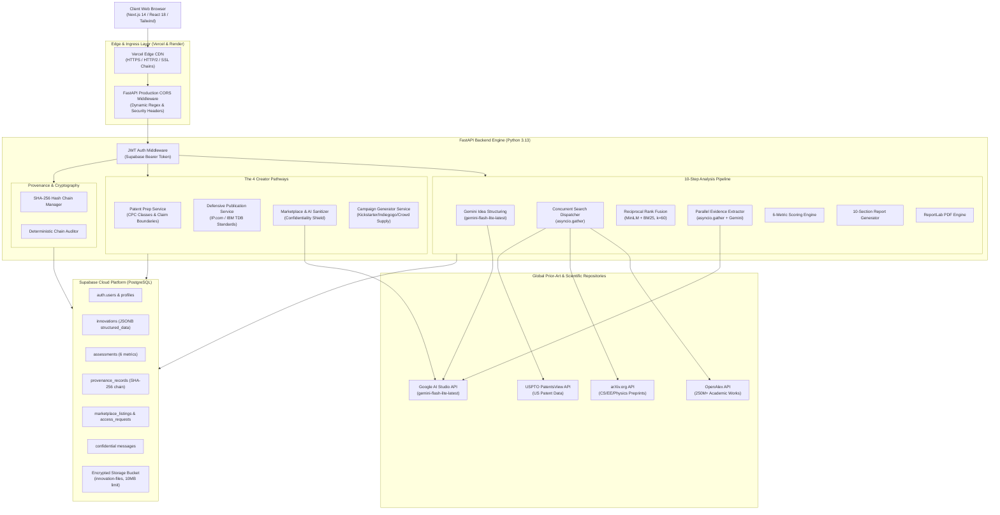
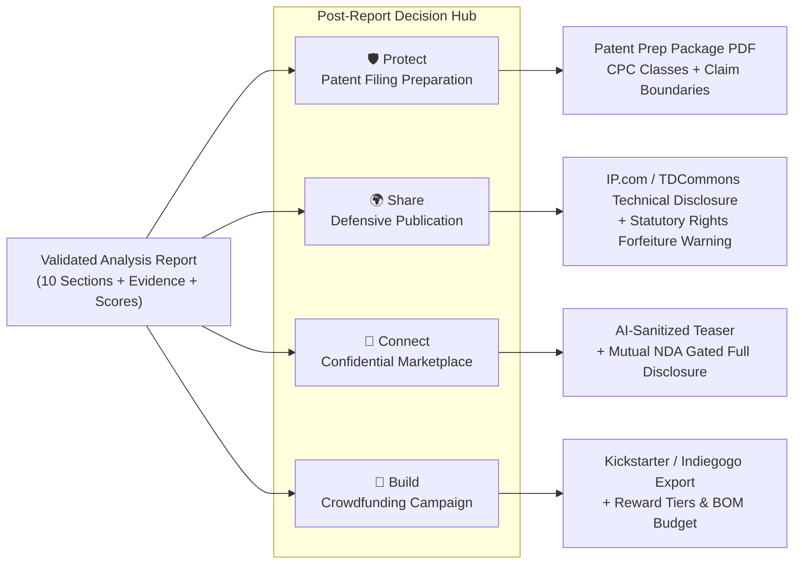

# InnovX — Technical System Architecture & Specification

> **Version:** 1.0.0 (Production Release)  
> **Document Date:** October 2026  
> **Classification:** Technical Reference & System Architecture  

---

## 1. High-Level Architectural Topology

InnovX employs a decoupled, asynchronous microservices architecture designed for zero API subscription costs, local CPU inference, and cryptographic tamper-evidence.

---

## 2. The AI & Search Triangulation Engine

### 2.1 Multi-Source Search Concurrency
To eliminate search bottlenecks, `backend/routers/analyze.py` executes queries against external APIs concurrently:

$$\text{Search Time} = \max\left(T_{\text{OpenAlex}}, T_{\text{arXiv}}, T_{\text{USPTO}}\right) \approx 1.2\text{s} \quad (\text{vs. } 4.5\text{s sequential})$$

### 2.2 Reciprocal Rank Fusion (RRF) Mathematical Formulation
Candidate documents from dense semantic vectors and sparse lexical search are fused using standard Information Retrieval Reciprocal Rank Fusion:

$$\text{RRF\_Score}(d \in D) = \sum_{m \in M} \frac{1}{k + r_m(d)}$$

Where:
* $M = \{\text{semantic}, \text{lexical\_BM25}\}$
* $k = 60$ (standard TREC / IR smoothing constant)
* $r_{\text{semantic}}(d)$ is the rank index sorted by cosine similarity between document embedding and feature embedding via `all-MiniLM-L6-v2` (384 dimensions).
* $r_{\text{lexical\_BM25}}(d)$ is the rank index computed using Okapi BM25 with parameters $k_1 = 1.5, b = 0.75$:

$$\text{BM25}(D, Q) = \sum_{i=1}^n \text{IDF}(q_i) \cdot \frac{f(q_i, D) \cdot (k_1 + 1)}{f(q_i, D) + k_1 \cdot \left(1 - b + b \cdot \frac{|D|}{\text{avgdl}}\right)}$$

---

## 3. The 4 Creator Execution Pathways

### Pathway Design & Guardrails:

| Pathway | Primary User Objective | System Guardrails & Output |
|:---|:---|:---|
| **🛡️ Protect** | Secure commercial monopoly via patent application | Identifies closest prior art gaps; drafts independent apparatus/method claim boundaries with narrower dependent fallbacks; provides 12-month provisional priority checklist and USPTO/EPO/WIPO fee schedules. |
| **🌍 Share** | Establish unrestricted Freedom-to-Operate (FTO) | Generates exhaustive technical disclosures (including alternative embodiment variations) formatted for IP.com and Google TDCommons; issues mandatory legal warning: public disclosure irrevocably forfeits patenting rights in absolute-novelty jurisdictions. |
| **🤝 Connect** | License or sell innovation to enterprise partners | Resolves Arrow's Information Paradox using an AI Sanitizer: public teasers describe domain problems and high-level value propositions while strictly concealing proprietary algorithms; full disclosures require signed Mutual NDA. |
| **🚀 Build** | Direct-to-consumer hardware crowdfunding | Formats campaign copy adhering to Kickstarter Prototype Policies; structures tiered backer rewards, video scripts with visual cues, and categorized budget allocations. |

---

## 4. Cryptographic Provenance Chain Design

InnovX enforces **Private by Default** and rejects speculative blockchain or token systems in favor of cryptographic SHA-256 version trees.

### 4.1 State Snapshot Hashing
Every version snapshot $S_n$ for innovation $I$ is canonically serialized and hashed:

$$H_1 = \text{SHA-256}\left(\text{JSON}_{\text{canonical}}\left(I, v=1, \text{prev\_hash}=\text{null}, D_1, T_1\right)\right)$$

$$H_n = \text{SHA-256}\left(\text{JSON}_{\text{canonical}}\left(I, v=n, \text{prev\_hash}=H_{n-1}, D_n, T_n\right)\right)$$

### 4.2 Tamper-Evident Verification Algorithm
When a creator or auditor clicks **"Verify Integrity"**, the engine executes `services/provenance.py`:
1. Asserts $H_1.\text{previous\_hash} = \text{None}$.
2. Iterates $i \in [2, N]$, verifying that $H_i.\text{previous\_hash} = H_{i-1}.\text{document\_hash}$.
3. If any database row is altered, the chain breaks at version $i$, flagging the compromised version within 5 milliseconds.

---

## 5. Security & Dual-Role Access Control Matrix

InnovX isolates creator intellectual property using Row-Level Security (RLS) policies in PostgreSQL and endpoint guards in FastAPI:

| Resource / Action | Creator (Owner) | Approved Buyer (Signed NDA) | Unapproved Buyer / Public |
|:---|:---:|:---:|:---:|
| Raw Idea Text & Full Features | ✅ Full Access | ✅ Full Access | ❌ Blocked (403 Forbidden) |
| Feature Matrix & Assessment | ✅ Full Access | ✅ Full Access | ❌ Blocked (403 Forbidden) |
| 10-Section PDF Report Stream | ✅ Full Access | ✅ Full Access | ❌ Blocked (403 Forbidden) |
| Vault Files (CAD, Schematics, Tests) | ✅ Upload / Delete / View | ❌ Blocked | ❌ Blocked (403 Forbidden) |
| Lab & Development Notes | ✅ Read / Write | ❌ Blocked | ❌ Blocked (403 Forbidden) |
| Sanitized Marketplace Teaser | ✅ Full Access | ✅ Full Access | ✅ Public (Sanitized only) |
| Mutual NDA Request / Sign | N/A (Receives & Reviews) | ✅ Signed & Executed | ❌ Pending Execution |
| Confidential Messaging Thread | ✅ Bidirectional Chat | ✅ Bidirectional Chat | ❌ Blocked (403 Forbidden) |

---

## 6. Production Infrastructure & Deployments

| Component | Target Platform | Runtime / Config | Health & Monitoring |
|:---|:---|:---|:---|
| **Frontend** | Vercel | Next.js 14 / Turbopack / Edge CDN | Strict HTTP security headers (`nosniff`, `DENY`, `strict-origin`) |
| **Backend** | Render.com | Python 3.13 / Uvicorn / Multi-stage Docker | `/health` probe with uptime, pre-warmed MiniLM, and service checks |
| **Database** | Supabase Cloud | PostgreSQL 15 + pgvector + RLS | Point-in-time recovery + JWT verification |
| **Object Storage**| Supabase Storage | `innovation-files` bucket (10MB per file) | 60-second expiring signed URLs |
