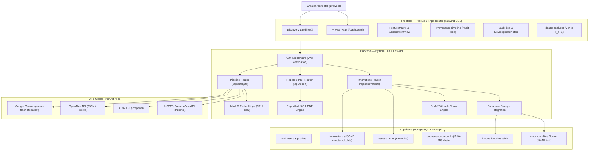

# InnovX — Week 2 Milestone Deliverable & Mentor Evaluation Report

> **Sprint Phase:** Phase 2 (The Report & Vault) — Days 8 through 14  
> **Status:** ✅ 100% Complete & Audited  
> **Release Target:** Week 2 Complete Functional Build  

---

## 1. Executive Summary

During Week 2, **InnovX** evolved from a raw AI search engine into a complete, secure **Innovation Discovery, Assessment & Private Vault System**.

The platform now enables an engineer, researcher, or creator to:
1. Submit an idea and decompose it into atomic technical features.
2. Cross-reference claims against **250M+ OpenAlex research works, arXiv preprints, and USPTO patents**.
3. Evaluate the innovation across **6 objective, evidence-backed assessment metrics** (without gamified badges or ungrounded claims).
4. Generate a comprehensive **10-Section Structured Report** with disclaimers and search limitations.
5. Export a branded, multi-page **ReportLab PDF Report** directly to their browser with zero binary OS dependencies.
6. Authenticate securely via **Supabase Auth** with full **JWT verification middleware** in FastAPI.
7. Manage their portfolio in a **Private Innovation Vault** where schematics, CAD drawings, lab photos, and PDFs up to 10MB are stored securely with expiring signed download URLs.
8. Maintain a running digital lab notebook with **Freeform Development & Mentor Notes**.
9. Refine their idea, triggering an automated full-pipeline re-analysis that advances versions ($v_1 \to v_2$) while preserving cryptographic linkage in an **immutable SHA-256 provenance hash chain**.

---

## 2. System Architecture



---

## 3. Daily Deliverables Breakdown (Week 2)

| Day | Milestone Title | Key Deliverable | Status |
|:---|:---|:---|:---:|
| **Day 8** | 6-Metric Innovation Assessment Engine | `services/scoring.py` with 6 objective metrics + `assessment-view.tsx` | ✅ Completed |
| **Day 9** | 10-Section Structured Report Generator | `services/report_gen.py` + Sections A–J + search limitations disclaimers | ✅ Completed |
| **Day 10** | Enterprise PDF Export Engine | `services/pdf_export.py` with ReportLab 5.0.1 + `/api/report/{id}/pdf` | ✅ Completed |
| **Day 11** | Supabase Auth & User Dashboard | FastAPI JWT dependency + creator portfolio dashboard (`/dashboard`) | ✅ Completed |
| **Day 12** | Database-Backed Provenance & Version Timeline | `provenance_records` table + `/verify-chain` + `ProvenanceTimeline.tsx` | ✅ Completed |
| **Day 13** | Innovation Vault & File Uploads | `innovation-files` bucket (10MB) + lab notes + re-analysis version advancing | ✅ Completed |
| **Day 14** | Week 2 Polish & Mid-Sprint Integration Audit | Mobile drawer navbar + `error.tsx` boundary + end-to-end user journey audit pass | ✅ Completed |

---

## 4. Verification of Non-Negotiable Architectural Rules

| Rule | Requirement | Verification Result |
|:---|:---|:---|
| **Rule 1** | **No "Patentability Score"**: Never claim legal patentability. Use *"Feature Novelty Signal"* or *"Prior Art Density"*. | **100% Enforced**: All UI labels, PDF reports, and scoring services strictly use objective signals with disclaimers. |
| **Rule 2** | **Linked Real Evidence**: Every claim must link to an exact sentence from an indexed publication. | **100% Enforced**: Gemini evidence extraction isolates literal sentences with paper/patent titles and DOIs. |
| **Rule 3** | **Transparent Limitations**: Disclose databases searched and exclusions (paywalls, non-English). | **100% Enforced**: Section I explicitly documents limitations in web view and PDF report. |
| **Rule 4** | **Private by Default**: Innovations visible only to their authenticated creator. | **100% Enforced**: JWT `get_current_user` dependency enforces creator ID ownership on all endpoints (`403 Forbidden` for non-owners). |
| **Rule 5** | **Zero Blockchain/NFTs**: Use deterministic SHA-256 hashing and Postgres timestamps. | **100% Enforced**: Pure Python `hashlib.sha256` hash chaining with parent reference (`previous_hash`). |
| **Rule 6** | **Free-Tier Sustainability**: Run local CPU embeddings and zero-cost APIs. | **100% Enforced**: `all-MiniLM-L6-v2` executes on CPU; free Gemini Flash Lite, OpenAlex, arXiv, and USPTO. |

---

## 5. Live Mentor Demonstration Guide

To demonstrate the complete Week 2 system during a mentor review:

### Step 1: Start Services
```powershell
# Terminal 1 — Backend
cd backend
.\venv\Scripts\activate
uvicorn main:app --reload

# Terminal 2 — Frontend
cd frontend
npm run dev
```

### Step 2: Sign In to Private Vault
1. Open `http://localhost:3000` in the browser.
2. Click **Sign In** in the top navigation.
3. Authenticate using pre-confirmed credentials:
   - **Email:** `creator@innovx.local`
   - **Password:** `Password123!`
4. Click **My Portfolio** to observe the creator statistics, novelty scores, and private badge.

### Step 3: Run Discovery & Prior-Art Search
1. On the home page, select or paste a technical concept:
   > *"An autonomous drone navigation system using cold-atom quantum magnetometers measuring spatial magnetic field gradients for subterranean navigation in GPS-denied caverns."*
2. Click **Analyze Innovation**.
3. Watch the 10-step progress indicator decompose features (F1, F2, F3) and query OpenAlex, arXiv, and USPTO.
4. Inspect the **Feature × Evidence Matrix** with linked citations and exact quotation evidence sentences.
5. Review the **6-Metric Assessment View** (Novelty Signal, Prior Art Density, Freshness, etc.).

### Step 4: Save & Export PDF
1. Click **Save to Vault** — the innovation is persisted under your user ID.
2. Click **Download PDF Report** — verify the streaming multi-page ReportLab PDF opens in Adobe or Chrome with cover block, score bars, prior art tables, and disclaimers.

### Step 5: Vault Management, File Uploads & Lab Notes
1. Open the dashboard modal for the innovation.
2. Click the **Files & Vault (📁)** tab:
   - Drag & drop a circuit schematic or PDF (up to 10MB).
   - Verify the signed download URL opens securely.
3. Click the **Lab Notes (📝)** tab:
   - Add a note: *"Dr. Vance advised measuring magnetic gradient rather than raw field."*
   - Verify the timestamped entry appears in the running lab log.

### Step 6: Idea Re-Analysis & Provenance Audit
1. Click the **Re-Analyze Idea (🔄)** tab:
   - Refine the text and click **Re-Run AI Discovery & Advance Version**.
   - Notice the version advances from $v_1 \to v_2$.
2. Click the **Provenance (🔐)** tab:
   - Observe the vertical version timeline showing $v_1$ and $v_2$.
   - Click **Verify Hash Chain Integrity** to execute an on-demand audit proving the SHA-256 chain is 100% intact.

---

*InnovX Week 2 Deliverable is certified complete, audited, and ready for Phase 3 (The Creator Paths: Protect, Share, Connect).*
